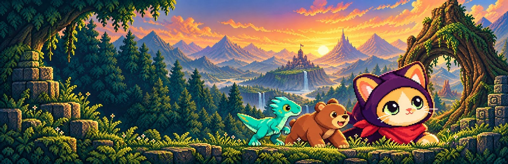
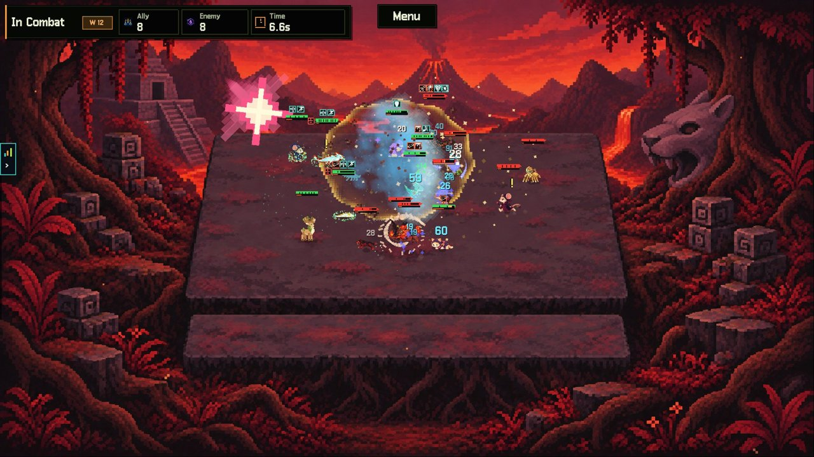
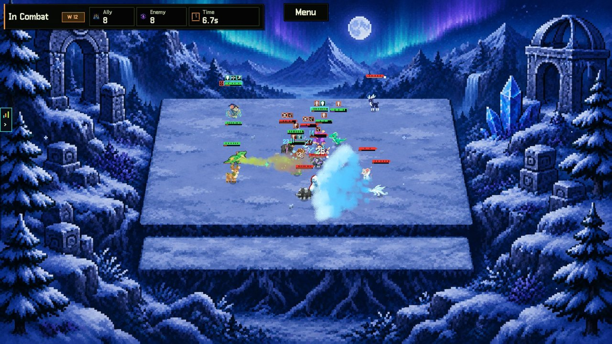
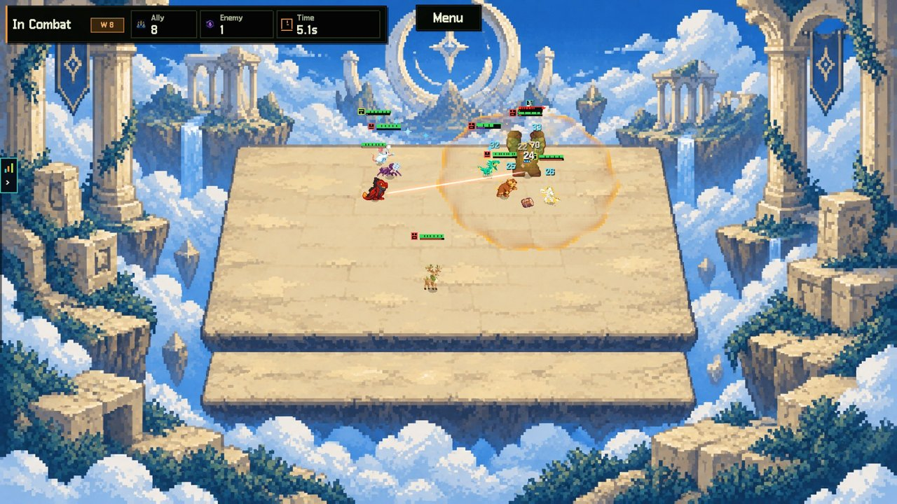
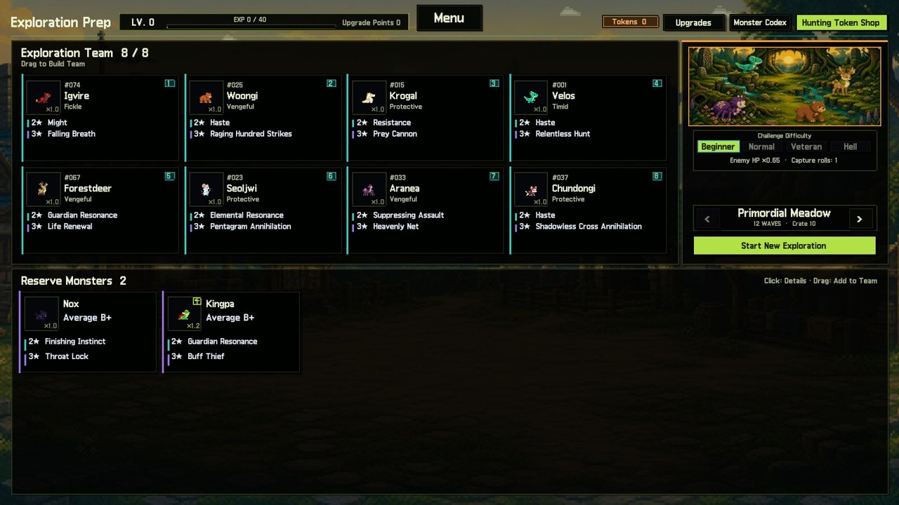
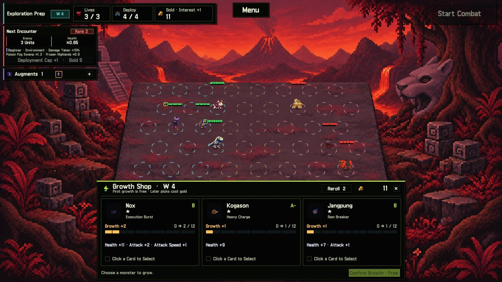
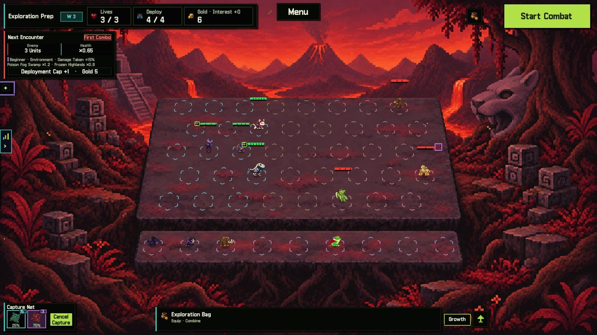
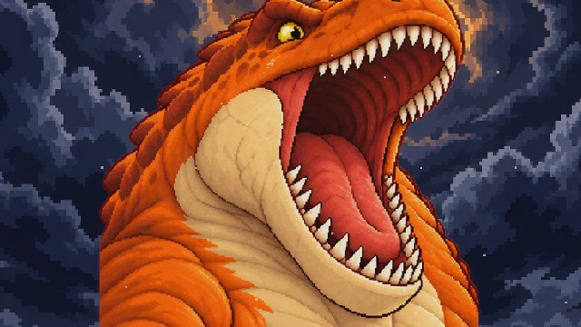
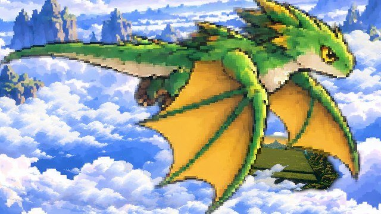
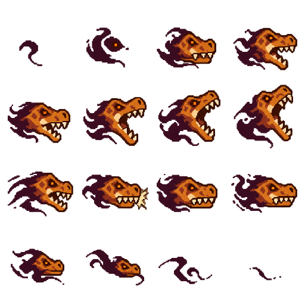

# BecomeZ: Wild Crew



**픽셀아트 몬스터 수집 오토배틀러 · Unity 2022.3 (URP) / C# · 1인 개발 · Steam 앞서 해보기 출시 준비 중**

몬스터를 포획해 크루를 꾸리고, 8대8 자동 전투로 12웨이브 원정을 돌파하는 로그라이트 오토배틀러입니다.
프로토타입이 아니라 저장·설정·현지화·스토어 에셋까지 갖춘 **판매 가능한 완성 게임**을 목표로,
AI(Codex · Claude Code · Unity MCP · 이미지 생성 AI)를 개발 파트너로 활용해 약 4개월 동안 1인으로 개발했습니다.

> 이 저장소는 **포트폴리오용 코드 공개 저장소**입니다. C# 런타임·에디터 코드, 테스트, 설계 문서, 도구 스크립트만 포함합니다.
> 아트·사운드 리소스, 유료 에셋, 씬·프리팹, 빌드는 포함하지 않아 이 저장소만으로는 실행되지 않습니다.

| 몬스터 | 지역 · 웨이브 | 특성 | C# 코드 | 자동 테스트 | 현지화 |
|:---:|:---:|:---:|:---:|:---:|:---:|
| 80종 (20계열) | 5지역 × 12웨이브 × 4난이도 | 202개 | 약 13.1만 줄 | 1,894개 | 한/영 1,807항목 |

## 스크린샷

| | |
|:---:|:---:|
|  |  |
|  |  |
|  |  |
|  |  |

## 게임 루프

```
시작 크루 영입 → 원정 준비·편성 → 8대8 자동 전투 → 성장 카드·증강·상점 → 포획으로 영입 → 보상·영구 연구
        ↑                                                                                  │
        └──────────────── 수집 · 연구 · 해금은 유지, 성장 · 등급 · 장비는 원정마다 초기화 ───────────┘
```

## 핵심 시스템

### 1. 스킬 연출 전용 시간 제어 — `CombatSkillClock`
16명이 동시에 싸우는 중 궁극기 연출이 나오면 다른 유닛은 멈추고 해당 스킬만 진행되어야 했습니다.
Unity 코루틴을 감싸는 스킬 전용 시계를 만들어, 중첩 코루틴을 스택으로 평탄화하고 `WaitForSeconds`를 스킬 시간 기준으로 재계산합니다. 파티클 재생 시간도 함께 보정합니다.

- [`Assets/Prototype/CombatSkillClock.cs`](Assets/Prototype/CombatSkillClock.cs)
- 스킬별 타임라인 상태 객체 예시: [`MonsterAutoBattleTyrannoMaw.cs`](Assets/Prototype/MonsterAutoBattleTyrannoMaw.cs). 준비 → 등장 → 당김 → 물기 단계로 진행하고, 세대·위치 버전 토큰으로 사망·빙결·이동 시 오래된 시전을 자동 취소합니다.

 AI로 만든 16프레임 시트를 Point 필터·무압축으로 가져와, 턱이 닫히는 9번 프레임에 피해 시점을 맞췄습니다.

### 2. Google Sheets → ScriptableObject 마스터 데이터 파이프라인
- 에디터 메뉴 한 번으로 19개 마스터 탭(Monster, Skill, Trait, Item, Wave, Localization 등)을 순서대로 받아 `GameMasterDatabase` 에셋을 만듭니다.
- 시트 조회 API(gviz)가 열 타입을 추정하면서 숫자형 텍스트를 버리는 문제를 발견해, 원본 값을 보존하는 CSV export 방식으로 바꿨습니다.
- [`Assets/Editor/GameMasterDatabaseSync.cs`](Assets/Editor/GameMasterDatabaseSync.cs), [`LocalizationDatabaseSync.cs`](Assets/Editor/LocalizationDatabaseSync.cs), [`Assets/Game/Core/GameLocalization.cs`](Assets/Game/Core/GameLocalization.cs)
- 공개 저장소에서는 스프레드시트 ID를 `YOUR_SPREADSHEET_ID`로 바꿔 두었습니다.

### 3. ML-Agents 배치 AI와 A/B 평가
- PPO로 "어떤 몬스터를 어느 타일에 배치할지"를 학습합니다. 관찰값은 316차원(웨이브, 지역, 난이도, 로스터 8칸, 타일, 적)이고, 행동 마스킹으로 잘못된 배치를 막습니다.
- 같은 시드 50쌍(100전)으로 A/B 평가한 결과 휴리스틱 28%, ML 18%였습니다. 그래서 출시 빌드는 휴리스틱을 유지하고, 다음 실험을 커리큘럼 학습으로 설계했습니다.
- [`Assets/Prototype/BombBrickBalanceAgent.cs`](Assets/Prototype/BombBrickBalanceAgent.cs), [`Config/mlagents/`](Config/mlagents), [`Docs/MLAgents_AB_Evaluation_PilotV1.md`](Docs/MLAgents_AB_Evaluation_PilotV1.md)

### 4. 검증 구조 — AI가 만든 코드를 그대로 믿지 않기
- `Assets/Tests/Editor`: EditMode 테스트 1,894개(TestCase 2,363행)가 빙결·배속·사망 시 스킬 취소, 전투 종료 정리, ML 관찰·행동 규격, 저장 데이터 호환을 검증합니다.
- 실제 전투를 수백 프레임 녹화해 피해가 정확한 애니메이션 프레임에 들어가는지 스크립트로 검사했습니다(설계 문서에 기록).
- `Assets/Editor/*RuntimeQa.cs`: 런타임 QA 에디터 스크립트 20여 개.

### 5. Steam 출시 준비
저장 손상 감지·복구, 저장 실패 재시도, 중복 실행 방지, 화면 흔들림·번쩍임 감소 옵션, 백그라운드 일시정지, 튜토리얼 다시 보기, 오류 로그 수집, 크레딧·라이선스 고지까지 출시 체크리스트 14개 항목을 구현했습니다.
- [`Docs/SteamReleaseReadiness_2026-09-25_KO.md`](Docs/SteamReleaseReadiness_2026-09-25_KO.md), [`Assets/Prototype/PlayerProfileStore.cs`](Assets/Prototype/PlayerProfileStore.cs)

## AI 협업 개발 방식

| 단계 | 담당 | 내용 |
|---|---|---|
| 설계 | 직접 | 스킬 수치·타이밍·연출을 설계 문서로 먼저 정의 ([`Docs/`](Docs), 146개) |
| 구현·에셋 | AI | Codex·Claude Code로 C# 구현, 이미지 생성 AI로 스프라이트·스토어 아트 제작 |
| 검증 | 자동 | EditMode 테스트, 실제 플레이 프레임 캡처, 콘솔 오류·경고 0 확인 |
| 피드백 | 직접 | 플레이 후 수정 지시, 결과를 인수인계 문서에 기록해 다음 작업으로 연결 |

## 폴더 구조

```
Assets/
  Prototype/   전투 런타임 (오토배틀, 스킬·특성, 상태이상, VFX, 카메라, ML 에이전트, 저장)
  Game/        게임 흐름·프론트엔드·현지화·오디오·설정
  Editor/      DB 동기화, 스프라이트·아틀라스 도구, 밸런스 리포트, 런타임 QA
  Tests/       EditMode 테스트
Config/mlagents/   ML-Agents 학습 설정 (PPO, 커리큘럼)
Docs/              설계·연출·사운드·출시 준비 문서
Tools/             텔레메트리 분석, 릴리스 고지 생성 등 스크립트
```

## 개발자

**김광수** · Game Client Programmer (Unity / C#)
- GitHub: [github.com/kodending](https://github.com/kodending)
- Portfolio: [Notion](https://enchanting-mass-898.notion.site/2026-aa0f0a3d67d583f387c7012018854564)

© 2026 PangStudio. All rights reserved. 이 저장소의 코드는 포트폴리오 열람 목적으로 공개하며, 재배포·상업적 이용을 허용하지 않습니다.
